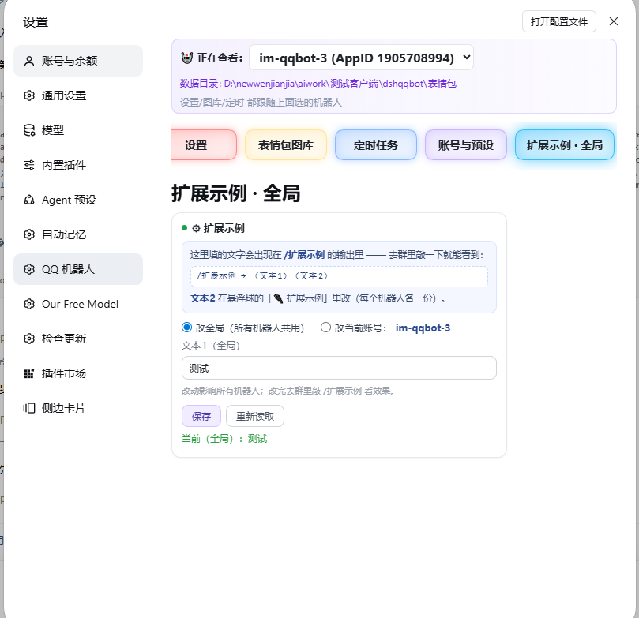
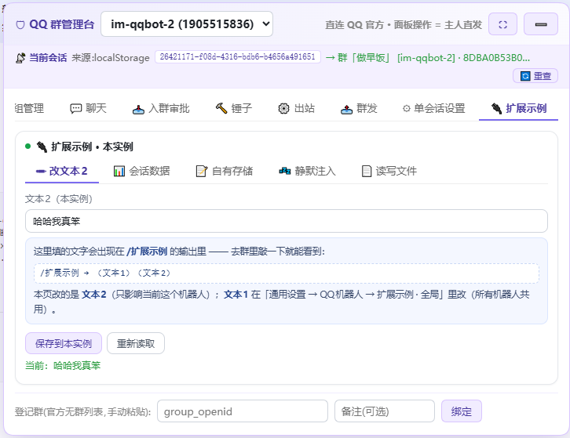

# 扩展契约（写 dsh-qqbot 扩展前，先读这一份）

> 适用版本：**v1.9.2+**（本文写的就是当前真实实现，不是设想）
> 面向：给 QQ 机器人写扩展的用户 / 让 AI 帮你写扩展的人
> 配套：用户手册 `README.md` §用户扩展、`docs/USER-GUIDE.md` §统一能力包、入站中间件详解 `examples/ext-inbound/README.md`

---

## 0. 一句话

**五套扩展点，一套能力包。** 你在哪一套里写代码，拿到的能力面都一样 ——
不用记五套 API，也不用"自己接生"发消息/存数据/调官方接口这些事。

```
                    ┌─────────────── 统一能力包（makeExtCaps）───────────────┐
  tools/      env ──┤ text markdown markdownCard media image voice video file│
  commands/   ctx ──┤ at api() appId/appSecret store registerInteractionCard  │
  botplay/    env ──┤ appendSilent appendWake canAppendSilent                 │
  hooks/      env ──┤ user owners peer log kernel restart                     │
  inbound/    ctx ──┤ + inbound: { annihilate rewrite forceWake decide       │
                    │              silentInto mute* message kv }  ← 只有它   │
                    └───────────────────────────────────────────────────────┘
```

`inbound` 那一组为什么只有它有值：**只有它跑在"一条消息正在进站"的时刻**，
"消灭/改写/覆盖 @ 判定"这些动作在别处没有对象。别的四套拿到的 `caps.inbound` 是
`undefined` —— **这是语义，不是缺失**。

---

## 1. 扩展点总览：五套代码扩展 + 一套 UI 扩展

全部位于 **`{数据根}/.qqbot-extensions/`** 下（数据根 = 工作目录里的 `dshqqbot/`）：

| 目录 | 什么时候跑 | 你的导出 | 你拿到 |
|---|---|---|---|
| `tools/*.mjs` | LLM 调这个工具时 | `export default { name, description, inputSchema, run(args, env) }` | `env`（能力包平铺） |
| `commands/*.mjs` | 用户敲 `/你的命令` 时 | `{ name, handler(ctx) }` | handler 的 `ctx`（能力包平铺） |
| `botplay/*.mjs` | 卡片按钮被点时 | `{ name, events: {...} }` | `env` |
| `hooks/*.mjs` | **插件启动时跑一次** | `export default async (env) => {}` | `env`（含 `env.caps`） |
| `inbound/*.mjs` | **每一条入站消息** | `export async function onInbound(ctx,next)` / `onDecide(ctx,next)`（或 `export default`） | 挂点的 `ctx` |

扫描规则（五套一致）：**只看目录下的直接子文件**，`.js` / `.mjs` / `.cjs`，按文件名排序；
子目录不扫描（可放私有模块）。改完文件调 `tools_reload`（或 `/tools-reload`）**即时生效**；
扩展命令需要重启宿主。

### 第六套：`ui/` —— 自定义界面卡片（2026-10-26 新增）

前五套是「代码模块」，`ui/` 是**静态资源**（html/css/js），由面板加载到 **Shadow DOM** 里跑。
它不参与 `import()`，所以放错位置只会被静默跳过，不会报错。

**两个源，按 slot 分**（放错源就不显示）：

| slot | 界面位置 | 放哪 | 语义 |
|---|---|---|---|
| `settings` | 设置页顶栏多一个页签 | `{PROFILE_ROOT}/.qqbot-extensions/ui/<目录>/` | **profile 级**，全局一份 |
| `dock` | 悬浮球面板多一个页签 | `{dataRoot}/.qqbot-extensions/ui/<目录>/` | **每实例一份**（能读当前会话数据） |

目录里放三个文件（都可不写，写什么加载什么）：

```
card.html   必需（没有它这个扩展就不出现）
card.css    可选，样式
card.js     可选，逻辑
```

**元信息**写在 `card.html` 前 2KB 的注释里：

```html
<!-- qqbot-ui: { "id": "demo", "slot": "dock", "title": "🔌 扩展示例", "order": 5 } -->
```

- `id` 可选：覆盖目录名。**同一个扩展的两张卡（settings + dock）应该给相同的 id**，
  这样它们共用同一份配置（`getConfig()`）；不给 id 就用目录名。
- `slot` 必填：`settings` 或 `dock`。
- `title` 页签文字；`order` 排序（小的在前，默认 100）。

**卡片里能用的东西**（`card.js` 里有两个全局变量：`qqbotExt` 和 `shadowRoot`）：

```js
// 身份
qqbotExt.extId                      // 你的扩展 id

// 配置（两级，见 §2.1）
qqbotExt.getConfig()                // 默认作用域（settings 卡=profile，dock 卡=data）
qqbotExt.getConfig('profile' | 'data')
qqbotExt.setConfig({...})           // 同理
qqbotExt.acct                       // 当前选中的账号 {id, ns, cwd, dataRoot, appId}

// 会话（只有 dock 卡有）
qqbotExt.dock.sid                   // 当前 web 会话 id（宿主 agent 表按它索引）
qqbotExt.dock.peerId / scope / ns
qqbotExt.dock.dataRoot / cwd
qqbotExt.dock.context()             // 实例 + 会话信息
qqbotExt.dock.sessions()            // 这个机器人管过哪些会话
qqbotExt.dock.history(n)            // 当前会话最近 n 条消息
qqbotExt.dock.members()             // 群友台账

// 能力（与代码扩展对齐，走白名单 RPC）
qqbotExt.store.load() / save(v)     // 数据根下的 KV
qqbotExt.kernel.get('服务名')        // 宿主服务（同 env.kernel.get）
qqbotExt.kernel.has('服务名')
qqbotExt.log('日志')                 // 进宿主控制台
qqbotExt.owners() / appIdOf()
qqbotExt.cap('fs.read', 路径)        // 读文本文件（≤2MB，只放行文本扩展名）
qqbotExt.cap('fs.write', 路径, 内容) // 写（自动备份 .bak-时间戳）
qqbotExt.cap('appendSilent', 文本)   // 往当前会话静默注入一条消息（不唤醒 AI）
qqbotExt.cap('text' | 'markdown', 文本)  // 发消息

// 自己的后端（见 §7）
qqbotExt.api('/你的路由')            // → /api/ext/dispatch?id=<你>&p=/你的路由
```

**写卡片的几条硬边界**（都是设计如此，不是 bug）：

1. **样式双向隔离**：Shadow DOM 让卡片样式不污染面板，但**面板的 CSS 变量/组件样式也进不来**，得自己写。
2. **碰不到面板 DOM**：`document.getElementById` 查不到外面 —— 只能操作**自己那张卡内部**。
   卡片内部用 `shadowRoot.getElementById(...)`。
3. **用不了面板的 React 组件**（`SButton` / `FieldRow` / `h`），只能手写原生元素。
4. **没有构建步骤**：不能写 TS/JSX，不能 `import` npm 包（`card.js` 是用 `new Function` 执行的）。
5. **一切数据走后端**：浏览器沙箱碰不了文件系统 —— 要读 SQLite/扫目录/跑 shell，
   都在 `hooks/` 或 `tools/` 里做完，`registerRoute` 注册成路由，卡片用 `api()` 取。

**崩溃隔离**：卡片脚本报错只白自己那张卡（外面套了 try/catch），不影响面板其他部分。

**两张图看懂**（都是 `examples/ext-ui/demo/` 跑出来的真实效果）：

设置页那张 —— 一张**全局 UI** 也能操作当前选中账号：



dock 那张 —— 五个子标签，右边三个演示了 dock 独有的能力（读会话数据 / 读写文件 / 静默注入）：



**示例**：`examples/ext-ui/demo/`（`settings/` + `dock/` 两套，启动时自动铺到对应位置）。
`examples/ext-commands/扩展示例.mjs` 是配套的 `/扩展示例` 命令，演示「全局改 + 实例改 +
命令读两级配置」的完整链路。

---

## 2. 统一能力包（五套代码扩展都有）

> `ui/` 卡片拿到的是**子集**，见 §1 末尾「卡片里能用的东西」——浏览器里没有 kernel、
> 没有 sender，服务端能力一律走 `/api/ext/dispatch?p=/__cap` 白名单 RPC。

### 2.1 扩展自己的配置：两级作用域

扩展可以有自己的配置，**存在两级**，互不干扰：

| 作用域 | 文件位置 | 谁在用 | 语义 |
|---|---|---|---|
| `profile` | `{PROFILE_ROOT}/.qqbot-extensions/.state/ext-config/<id>.json` | 设置页的 UI 卡片（默认）、需要全局配置的代码扩展 | **所有机器人实例共用一份** |
| `data` | `{dataRoot}/.qqbot-extensions/.state/ext-config/<id>.json` | dock 的 UI 卡片（默认） | **每个机器人实例各一份** |

代码扩展里用 `env.getConfig?.(scope)` / `env.setConfig?.(patch, scope)`（老版本可能没有，
自己读文件也行）；UI 卡片里就是 `qqbotExt.getConfig(scope)` / `setConfig(patch, scope)`。

**取值建议：实例优先、全局兜底**。典型写法（见 `examples/ext-commands/扩展示例.mjs`）：

```js
const t1 = dataCfg.text1 || profileCfg.text1 || '(默认值)';
```

这样「全局」才是真正的**默认值**，用户给某个机器人单独调过就以那个为准 ——
而不是硬性覆盖。

**写前自动备份**：`setConfig` 落盘前会把旧文件存成 `.bak-<时间戳>`，改坏了能捞回来。

### 2.2 注册自己的 HTTP 路由

扩展想用自己的存储（SQLite / 自有 json / 任意目录），就得有办法把数据交给自己的 UI 卡片。
在 `hooks/` 或 `tools/` 里注册：

```js
export default async (env) => {
  env.registerRoute('GET', '/rows', async ({ query }) => myDb.all(...), '你的扩展id');
  env.registerRoute('POST', '/add', async ({ body }) => { myDb.insert(body); return { ok: true }; }, '你的扩展id');
};
```

卡片里：

```js
qqbotExt.api('/rows').then(r => r.data)
```

**实现细节**：实际请求走 `/api/ext/dispatch?id=<你的id>&p=/rows`，由宿主派发。
handler 返回 `{ok:false,...}` 会原样透传，其它值包成 `{ok:true, data}`。
`method` 传 `'*'` 表示任意方法都收。注册表放 `globalThis.__qqbotExtRoutes`（跨模块图）。

**注意**：`hooks/` 是「插件启动时跑一次」，拿到的 `env.dataRoot` 是**插件级**的
（主实例那份），不是当前机器人实例的。需要按实例工作时，从**请求参数**里取
（`query.dataRoot` / `query.sid`），别依赖 `env.dataRoot`。

成员**平铺**在你的 `env` / `ctx` 上，**同时**在命名空间 `env.caps` / `ctx.caps` 里也有一份。

| 能力 | 用法 | 说明 |
|---|---|---|
| 发纯文本 | `await env.text('hi')` | |
| 发 markdown | `await env.markdown('# 标题')` | 富文本卡片通道，**自带纯文本降级** |
| 发 markdown+按钮 | `await env.markdownCard(md, keyboard)` | 自己拼 keyboard（≤5 行） |
| 发富媒体 | `await env.image(src)` / `voice` / `video` / `file` | `src` 可传 URL 字符串或 `{url}` / `{localPath}` |
| 任意媒体 | `await env.media('file', src)` | kind = image / voice / video / file |
| @人 | `env.at(openid)` | 返回 `<@openid>` 片段，拼进文本 |
| 官方 API | `await env.api('/v2/users/@me')` | **自带 token 与 2h 缓存**；返回 `{ok,data}` 或 `{ok:false,err:{code,human}}` |
| 钥匙 | `env.appId` / `env.appSecret` | 想自己换 token 调任意接口时用 |
| 持久化 | `env.store.load()` / `env.store.save(obj)` | 落 `…/data/<你的文件名>.json`，**升级插件不丢** |
| **进上下文（静默）** | `await env.appendSilent('...')` | **只落上下文、不唤醒**（详见 §4 安全红线） |
| 进上下文（唤醒） | `await env.appendWake('...')` | 走正常回合唤醒一轮 AI（耗 token） |
| **点名唤醒任意会话** | `await env.caps.wakeTo(scope, peerId, text)` | **不需要「当前会话」**，直接点名唤醒某个群/私聊里的 AI。`scope`=`group`/`c2c`，`peerId`=群 openid / 用户 openid。走正常回合：AI 带着该会话的历史与人设自己作答，回复由宿主发到 QQ。<br>**会话被回收、或宿主重启后活跃表为空时，会自动 `getOrCreate` 重建再注入**，调用方不用管。<br>返回 `true`=已排进该会话的回合；宿主没接/找不到目标=`false`（**不抛错**，调用方自己决定回退）。⚠️ `true` 不等于 QQ 一定送达。 |
| **身份** | `env.user.openid` / `env.user.name` / `env.user.isOwner` | 当前发言者。`isOwner` 已按主人白名单**算好布尔值**，直接 `if (!env.user.isOwner) return` 即可，不必自己比数组 |
| **主人判定（便捷）** | `env.isOwner` | 等价于 `env.user.isOwner` 的顶层布尔，最省事的写法 |
| **主人白名单** | `env.owners`（`string[]`） | 原始 openid 数组，`[]` = 未配置主人 |
| **发送者 openid（平铺）** | `env.actorOpenid` | 与 `env.user.openid` 同值。v1.10.42 起才真正暴露（此前只在内部算 `isOwner` 时用到） |
| **会话标识** | `env.peer.scope` / `env.peer.peerId` | `scope` = `'group'` / `'c2c'`；`peerId` = 群 openid 或用户 openid |
| **宿主配置** | `env.config.appId` / `env.config.appSecret` / `env.config.owners` | 给「想自己换 token 调接口」或「自己判主人」的扩展用。⚠️ 命令侧 `ctx.config` **同时**还包含该扩展自己的设置项（面板里填的值），两者合并 |
| **本会话 id** | `env.peerSessionId` | 本 QQ 会话对应的 **DSH 会话 id**（= `session/event` 里那个 `session.id`）。⚠️ **不是 `agent.id`** —— 跨会话回灌/引用回流判"父会话"用的正是它。v1.10.0 起提供；命令与按钮回调侧都能拿到（回调侧字面同值，直接读即可） |
| 日志 | `env.log(...)` | 落插件 logger |
| 内核句柄 | `env.kernel`（工具侧也叫 `env.ctx`） | **全权限"遥控器"**：`ctx.get('服务名')` / `ctx.on(...)` / `ctx.webServer.register(...)`。⚠️ 形状跟随 dsh 版本；`register` 返回的 disposer 要自己收尾 |
| 宿主自重启 | `await env.restart()` | 复用内置 `/bot-restart`（自动识别启动命令、强补 `--no-open`）。默认**仅主人**可触发；要放开写 `env.restart({ requireOwner: false })` |
| 回调按钮卡 | `env.registerInteractionCard({cardId, buttonIds, expireAt})` | 发**带回调按钮**的卡片必须先登记，否则点了没人认 |

### 扩展设置页的字段类型（schema）

扩展文件里 `export const qqbotSettingsPage = { title, desc, schema: [...] }`，面板就会给它生成设置页。
`schema` 每项支持：

| type | 控件 | 说明 |
| --- | --- | --- |
| `bool` | 开关 | 值 true/false |
| `number` | 数字框 | 值 number |
| `string`（默认） | 输入框 | 加 `secret: true` 变密码框 |
| `list` | 多行文本 | 一行一项，值 string[] |
| `select` | 下拉 | `options` 可写字符串数组，也可写 `{ value, label }` |

**`select` + `searchable: true`（1.10.46 起）**

选项很多（几十上百条）时，原生 `<select>` 根本没法找。加上这个标记会渲染成
`<input list="…"> + <datalist>`：浏览器原生**输入过滤**，并且**允许手填列表外的值**。

```js
{ key: 'defaultSpeaker', type: 'select', searchable: true, label: '默认音色',
  default: 'Vivi 2.0｜zh_female_vv_uranus_bigtts',
  options: VOICES.map(v => v.label) }   // ['中文名｜voice_type', ...]
```

⚠️ 两个必须注意的点：

1. **`select` 取到的值永远是字符串**（`'24000'`，不是 `24000`）。
   如果你的扩展要把它传给要求严格类型的第三方接口，**自己转数字**，否则会像 TTS 那样撞
   `55000000 cannot unmarshal string into ... of type int`。
2. 用 `中文名｜id` 这种复合值时，**读取侧要负责剥出真值**（本项目 TTS 包用 `pickSpeaker()` 统一处理）。

### 扩展包声明「最低插件版本」（1.10.44 起）

包的清单文件里可以写 `minPluginVersion`，面板会拿它跟当前装的插件版本对照，不满足就标红：

```json
{
  "name": "主动陪伴与私聊关怀",
  "version": "1.0.6",
  "minPluginVersion": "1.10.44"
}
```

规则：

- **不写 = 不检查**，任何插件版本都允许安装
- 写了的包，市场卡片与扩展总览都会显示「需要插件 vX」；当前版本低于它时红字提示「需要插件 ≥ vX（当前 vY）」
- 扩展总览接口同时返回 `pluginVersion`（插件自身版本），面板顶部「插件版本 vX.Y.Z」那一行就是它
- **用了新能力就应该声明**，否则老用户装上去会在运行期撞 `undefined`

### 主动唤醒别人的会话：怎么写 prompt

`caps.wakeTo` 的第三个参数会被当成**用户消息**注入目标会话，所以写法上有三个要点：

1. **自报家门**：`（系统提示，不是主人说的话）现在是 22:50，你和主人已经有 3 小时没有互动了。` —— 否则 AI 会以为对方真的开口了
2. **说清要它做什么**：`这次想主动做的是：晚安陪伴。请主动发一条私聊消息，一到两句，用你自己的语气说。`
3. **禁止项**：`不要提"系统""提醒""定时""唤醒"这些词，不要解释你为什么突然说话。`

⚠️ 唤醒可能被**价值评分**拦掉：纯打招呼、纯「我收到了」这类内容容易被判低价值而不产生回合。要唤醒就写清「为什么找你 + 要你做什么」；纯告知请改用 `appendSilent`。


---

## 3. 入站操控：`caps.inbound`（只有入站扩展有）

入站扩展的两个挂点，**链上位置决定你能做什么** —— 这是最重要的一张表：

| | 早（`onInbound`） | 晚（`onDecide` / `export default`） |
|---|---|---|
| 链上位置 | 引用解析**之后**、**记群历史之前** | @门控**之后** |
| 读得到 | `ctx.message` / `ctx.state.quote` / `ctx.platform.mentioned` | 以上全部 **+ `ctx.state.mention`**（门控判定结果） |
| `annihilate` 消灭 | ✅ 真消灭（不进历史/不进上下文/不占冷却） | ❌ 会被拒绝 + 告警（历史已记） |
| `rewrite` 改写 | ✅ **连群历史一起改** | ⚠️ 只改后续上下文，历史已是原文 |
| `forceWake` 强制入站 | ✅ | ✅ |
| `decide` 覆盖 @ 判定 | ❌（判定还没写出来） | ✅ |
| `silentInto` 静默进上下文 | ✅ | ✅ |
| 禁言 / kv | ✅ | ✅ |

动作清单：

```
ctx.caps.inbound.annihilate({reason})      // 不调 next()：这条不进群历史、不进上下文、不占冷却
ctx.caps.inbound.rewrite({text,reason})    // 换掉正文（早挂点连历史一起换）
ctx.caps.inbound.forceWake({reason})       // 跳过 @门控 / 价值评分 / 群冷却
                                           //   ⚠️ 只是"必进"，不代表她一定会说话
ctx.caps.inbound.decide({mention:'ignore'|'force', reason})   // 覆盖 @ 判定
ctx.caps.inbound.silentInto(text?)         // 内容进 AI 上下文、不唤醒（走宿主 agent.inject）
ctx.caps.inbound.muteUser/unmuteUser/isMuted/mutedUsers       // 用户维禁言（带期限、持久化）
ctx.caps.inbound.message.{text,sender,senderName,scope,groupId,isOwner,mentions,quoted,platform}
ctx.caps.inbound.kv.get/set                // 该扩展自己的持久化
```

同一套动作在 `ctx` 上**也平铺了一份**（`ctx.annihilate` / `ctx.silentInto` / `ctx.muteUser` …），
两者是同一套内核的两个入口，随便用哪个。

### 示例：引用"子会话转发消息"不算 @

```js
// {数据根}/.qqbot-extensions/inbound/no-wake-on-child-quote.mjs
export default async function (ctx, next) {
  if (ctx.message.kind === 'group') {
    const quoted = ctx.state?.quote?.text ?? '';
    if (/【子会话(?:\s|\u3000|$)/.test(quoted) && ctx.state?.mention?.wasMentioned === true) {
      ctx.decide({ mention: 'ignore', reason: '引用的是子会话转发消息' });
    }
  }
  return next();
}
```

### 示例：广告直接消灭 + 静默留档

```js
export async function onInbound(ctx, next) {
  if (isAd(ctx.text)) {
    ctx.silentInto();          // 内容仍进她上下文（下次跑就能看到）
    ctx.annihilate({ reason: '广告' });
    return;                    // ★ 不调 next() = 不进历史/不占冷却/不叫醒
  }
  return next();
}
```

---

## 4. 四条安全红线

1. **`appendSilent` 的人设红线**：dsh 要求"人设"是会话上下文的**第一个节点**。
   全新会话（还没跑过任何回合）里静默追加会**把整份会话日志写废**，用户会看到「历史加载失败」。
   所以此能力**内置守卫**：不安全时直接返回 `false`、**绝不写入**。想在这种会话里送内容，用 `appendWake`。
2. **主人白名单最高优先**：主人（`config.groupAdmin.owners`）的消息**不可被 `annihilate` 消灭、不可被禁言** ——
   扩展这么调会被拒 + 告警 + 落审计，消息照常放行。
   （`silentInto` 不受此限：内容仍进上下文，不存在"被吞"风险；但它照旧落审计、计入熔断。）
3. **熔断**：单个扩展的破坏性动作占比过高（>50%，样本 ≥50）或短时爆发（10 秒内 ≥20 次），
   插件会**自动停掉它的破坏性动作**并告警 —— 消息改回放行，不会因为你的 bug 静默吞群消息。
4. **优雅降级**：任何能力拿不到依赖都返回 `false` / 结构化错误，**绝不抛**；
   你写的扩展抛错时，插件**只告警 + 继续 `next()`** —— 用户脚本坏了永远不会把消息吞掉。

另外：所有动作都会落 **`{数据根}/.qqbot-extensions/inbound/.state/audit.jsonl`**（带轮转），
禁言名单与 kv 落同目录的 `<你的文件名>.json`，**随时可回看、可撤销**。

---

## 5. 三条容易踩的坑

1. **`text` 同名冲突（只有入站侧）**：入站 `ctx.text` = **当前这条消息的正文**（读）；
   其余四套 `env.text('...')` = **发一条纯文本**。入站侧要发文本请走 `ctx.caps.text('...')`。
2. **入站是热路径**：两个挂点**每条消息都跑一遍**。别在这儿发消息、打接口、做长任务 ——
   `markdown` 会真发群、`appendWake` 会唤醒一轮 AI、`api()` 走网络。
3. **能力包"只补不覆盖"**：插件往你的 `ctx` 上合并能力时，判据是"**值为 undefined 才补**"
   （中间件 ctx 上不少键存在但值是 undefined）。你自己已经定义的同名成员不会被抢走。

---

## 6. 我能写哪一套？怎么选

```
有人敲命令才做事            → commands/
LLM 该主动调用才做事        → tools/
要等人点卡片按钮            → botplay/
启动就得跑一次（恢复任务/起定时器/预取） → hooks/
要影响"每条消息进不进、长什么样、叫不叫醒她" → inbound/
```

写之前建议先读 `examples/` 下对应目录的示例（插件首次启动会**自动铺一份**到你的扩展目录；
`examples/ext-inbound/` 里只有 `no-wake-on-child-quote.mjs` 会自动铺，
`class-advisor.mjs` 那种**会真删消息/真封人**的示例要自己拷）。

---

## 7. 变更记录（契约相关）

- **v1.9.2**：入站扩展（第五套）**能力面对齐** —— 直接复用统一能力包（此前只有一套私有小 ctx，
  `store` / `api()` / `markdown` / `appendSilent` 等一项都没有）；**入站操控那一组也进了包**（`caps.inbound`）。
- **v1.9.0**：新增第五套扩展点 `inbound/`（早/晚双挂点 + 四个动作 + 四条保命件）。
- **v1.8.9**：新增第四套扩展点 `hooks/`（启动钩子）。
- **v1.7.0**：三套（命令/工具/卡片）能力面统一为「统一能力包」。
